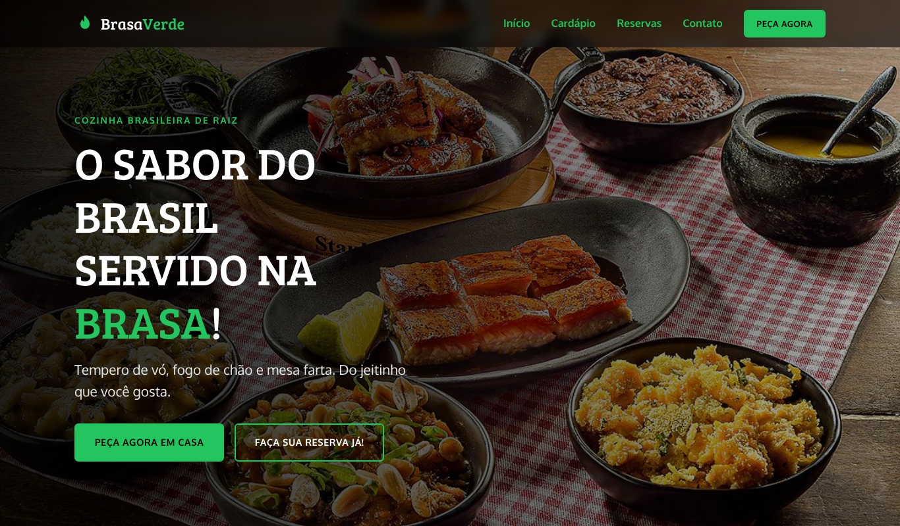
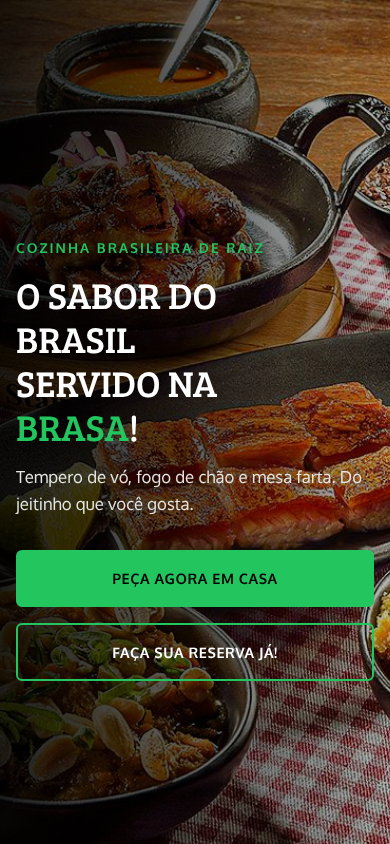

# Brasa Verde | Landing page de restaurante brasileiro

> Landing page responsiva para um restaurante de comida brasileira, com identidade visual em preto e verde, cardápio interativo, reservas pelo WhatsApp e FAQ. Feita com HTML, CSS e JavaScript puros.


<p align="center">
  
  &nbsp;
  
</p>

---

## Sobre o projeto

O **Brasa Verde** é uma landing page pensada para converter visitantes em clientes: em todas as dobras do site existe um caminho direto para **pedir em casa** ou **reservar uma mesa**.

A proposta visual usa o **preto** como base, para dar sofisticação e deixar as fotos dos pratos em destaque, e o **verde** como cor de ação, remetendo ao frescor e às cores do Brasil.

> "Brasa Verde" é um restaurante fictício, criado para este projeto de estudo. Cardápio, preços, depoimentos, endereço e telefone são conteúdo de exemplo.

---

## Funcionalidades

- **Layout responsivo** para celular, tablet e desktop
- **Menu hambúrguer** no mobile (fecha ao clicar em um link ou apertar `Esc`)
- **Cabeçalho fixo** que escurece ao rolar a página
- **Cardápio em abas** (Pratos, Petiscos, Bebidas e Sobremesas), navegável pelas setas do teclado
- **Reserva pelo WhatsApp**: o formulário valida os campos, bloqueia datas passadas e abre o WhatsApp com a mensagem pronta
- **FAQ em acordeão**, com uma resposta aberta por vez
- **Animações de entrada** ao rolar, desativadas para quem prefere menos movimento (`prefers-reduced-motion`)
- Botão **voltar ao topo** e ano do rodapé atualizado automaticamente

---

## Seções da página

1. **Hero**: foto de pratos brasileiros com os CTAs "Peça agora em casa" e "Faça sua reserva já!"
2. **Fome de quê?**: apresentação do cardápio variado
3. **Delivery**: atalhos para pedir pelo WhatsApp ou por aplicativo
4. **Os favoritos da casa**: cardápio com preços
5. **Depoimentos**: avaliações de clientes
6. **Sobre nós**: o manifesto da casa
7. **Reservas**: formulário integrado ao WhatsApp
8. **Perguntas frequentes**
9. **Rodapé**: mapa, endereço, horário, redes sociais e contato

---

## Identidade visual

| Cor | Hex | Uso |
|-----|-----|-----|
| Preto | `#000000` | Base do site, contraste e sofisticação |
| Verde | `#22C55E` | Botões (CTAs), links, preços e destaques |
| Verde escuro | `#15803D` | *Hover* dos botões e estrelas |
| Verde profundo | `#0B3D20` | Bordas, divisórias e degradês |
| Branco | `#FFFFFF` | Textos, cartões e seção de FAQ |

**Tipografia** (Google Fonts):
- **Bree Serif** nos títulos: serifa robusta, com personalidade e cara de "mesa farta".
- **Oxygen** nos textos, menu e FAQ: limpa e confortável para ler no celular.

Todas as cores ficam em variáveis CSS no topo de `css/style.css`, então a paleta inteira muda em um só lugar.

---

## Estrutura de pastas

```
brasa-verde/
├── index.html                  # Página principal
├── brasa-verde-site.html       # Versão em arquivo único (CSS, JS e imagens embutidos)
├── css/
│   └── style.css               # Estilos, paleta e responsividade
├── js/
│   └── script.js               # Menu, abas, FAQ, reserva e animações
├── assets/
│   └── img/
│       ├── comida-brasileira.jpg
│       └── rodizio-brasileiro.webp
├── docs/
│   ├── preview.png             # Prévias usadas neste README
│   └── preview-mobile.png
└── README.md
```

---

## Como executar

Não precisa instalar nada.

```bash
# 1. Clone o repositório
git clone https://github.com/SEU-USUARIO/brasa-verde.git

# 2. Entre na pasta
cd brasa-verde

# 3. Abra o index.html no navegador
#    ou rode um servidor local:
python -m http.server 8000
# e acesse http://localhost:8000
```

No VS Code, a extensão **Live Server** também funciona (botão direito em `index.html` → *Open with Live Server*).

> O `index.html` precisa ficar junto das pastas `css/`, `js/` e `assets/`. Se quiser só visualizar rapidamente, abra o `brasa-verde-site.html`, que funciona sozinho.

---

## Publicar no GitHub Pages

1. Suba os arquivos para o repositório.
2. Vá em **Settings → Pages**.
3. Em *Source*, escolha a branch `main` e a pasta `/ (root)`.
4. Salve. Em alguns minutos o site fica disponível em `https://SEU-USUARIO.github.io/brasa-verde/`.

---

## Como personalizar

| O que mudar | Onde |
|-------------|------|
| Nome do restaurante | Procure por `Brasa Verde` em `index.html` e `js/script.js` |
| WhatsApp | Constante `WHATSAPP` em `js/script.js` e links `wa.me` em `index.html` (formato `55` + DDD + número) |
| Cores | Variáveis em `:root` no início de `css/style.css` |
| Pratos e preços | Listas `<ul class="menu-list">` em `index.html` |
| Depoimentos | Blocos `<article class="review">` em `index.html` |
| Endereço e mapa | Rodapé de `index.html` (troque `q=Rio+de+Janeiro` no `iframe`) |
| Fotos | Pasta `assets/img/` e os atributos `src` e `alt` em `index.html` |

---

## Acessibilidade

- Textos alternativos em todas as imagens e `aria-label` nos ícones
- Abas, acordeão e menu com atributos ARIA e foco visível pelo teclado
- Bom contraste de cores (texto preto sobre verde, branco sobre preto)
- Respeita a preferência do sistema por menos movimento

---

## Autora

Desenvolvido por **Dulce Maria dos Santos Barbosa**.

---

<p align="center">Feito com muito tempero brasileiro.</p>
